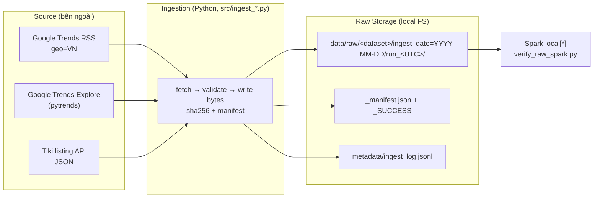

# Kiến trúc – Checkpoint 2

## Phạm vi đã triển khai (boundary của nhóm)

## Công nghệ
| Tầng | Công nghệ | Lý do |
|---|---|---|
| Runtime | Python 3.11, JDK 17 (Temurin), PySpark 3.5.3, `local[*]` | Mức A theo slide – setup nhanh, debug dễ, đủ cho quy mô dữ liệu hiện tại |
| Ingestion | `requests`, `pytrends` | Nguồn là HTTP API/RSS, không cần Kafka/NiFi ở checkpoint này |
| Raw storage | Local filesystem, partition `ingest_date=`/`run_` | Tương thích HDFS/S3 (cùng convention), Spark đọc trực tiếp |
| Trace | `_manifest.json` mỗi run + `ingest_log.jsonl` toàn cục | Truy vết source / time / bytes / sha256 / status |

## Trade-off chính
Chọn **local PySpark + filesystem** thay vì HDFS/cluster: tái tạo được trên mọi máy trong ≤10 phút,
đổi lại chưa thể hiện xử lý phân tán thật; convention path đã giữ nguyên để chuyển sang HDFS/S3 chỉ
bằng cách đổi `RAW_ROOT`.

## Lộ trình sau Checkpoint 2
Raw → **Staging** (Spark: parse JSON/CSV/XML, chuẩn hoá schema, dedup theo `product_id`+snapshot) →
**Feature** (growth rate từ khoá, sold velocity, rating) → **Trend score + nhãn affiliate**
(`HOT/RISING/STABLE/COLD`) → dashboard/API.
